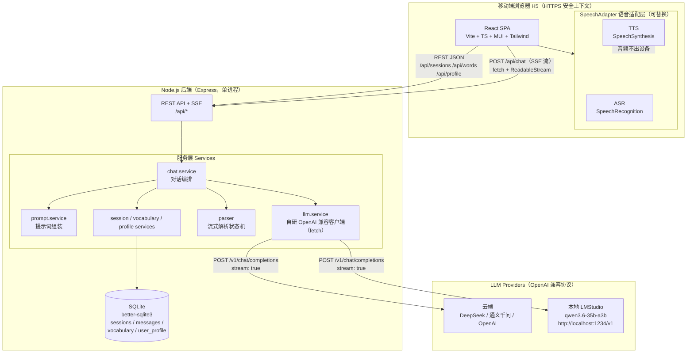
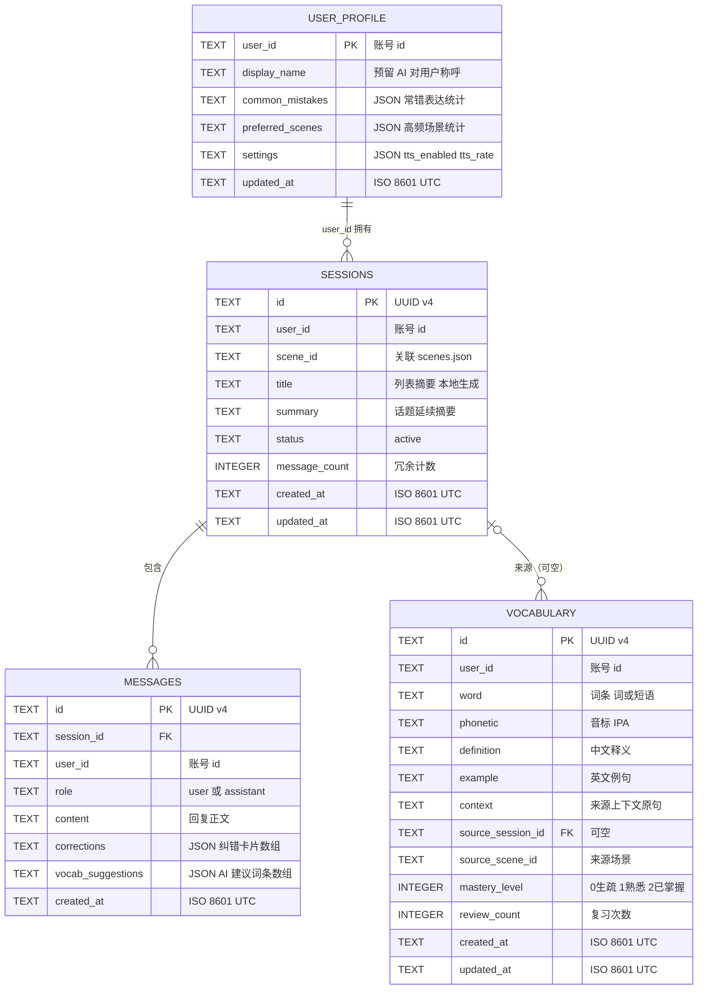
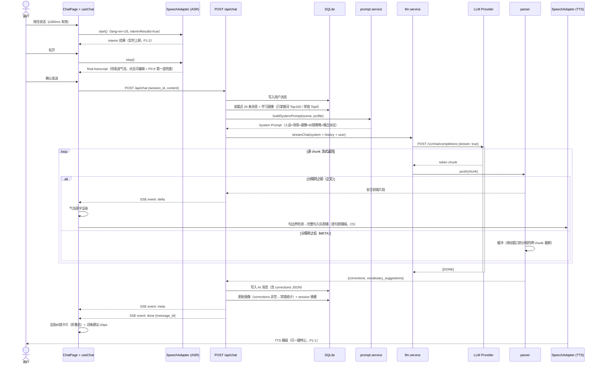
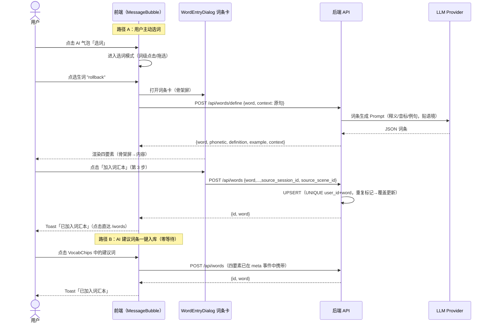
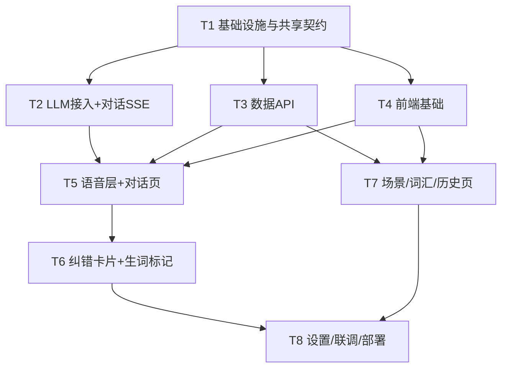
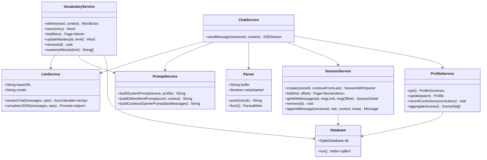

# SpeakMate（口语搭子）系统架构设计文档

| 项目信息 | 内容 |
|--------|------|
| 文档版本 | v1.0 |
| 日期 | 2026-09-04 |
| 撰写人 | 高见远（Gao）· 架构师 |
| 输入 | PRD v1.0（许清楚 · Xu）及客户已确认技术决策 |
| 状态 | 待工程师（Engineer）评审排期 |

---

## 0. 设计原则

1. **单用户轻量优先**：不引入 Redis / 消息队列 / 微服务 / Docker 编排等任何非必要组件；一个 Node 进程 + 一个 SQLite 文件即完成部署。
2. **API-first 边界清晰**：前端永不直连 LLM，所有能力经 `/api/*` 暴露，为小程序 / Android / iOS 复用铺路（PRD §6.4）。
3. **可配置而非可扩展过度**：LLM provider、产品显示名、模型、超时均走环境变量；语音层做接口抽象（SpeechAdapter）但不做多实现。
4. **流式体验是第一公民**：SSE 逐字渲染 + 首句即播 TTS，贯穿前后端契约设计。

---

## 1. 实现方案总览

### 1.1 总体架构图



要点：
- **LLM 请求全部由后端代理**（P0-11），API Key 只存后端 `.env`，前端网络请求零暴露。
- **浏览器 ASR/TTS 是纯前端能力**，与后端无关，未来可整体替换 SpeechAdapter 实现而不动业务组件。
- 生产模式下 Express 托管 `frontend/dist` 静态文件，前后端同源，免去 CORS 与多进程部署。

### 1.2 框架选型决策

#### Express vs Fastify —— **选 Express**

| 考量维度 | Express（选定） | Fastify |
|---------|----------------|---------|
| SSE 流式响应 | 原生 `res.setHeader + res.write` 直写，心智模型最简单 | 需绕过 reply 封装（`reply.raw` / hijack），与生命周期钩子有交互坑 |
| 单用户性能 | 足够（瓶颈在 LLM 网络 IO，不在 HTTP 框架） | 高吞吐 JSON 序列化优势在此场景收益≈0 |
| 生态与排障资料 | cors / helmet / morgan / better-sqlite3 一手示例丰富 | 资料相对少 |
| 客户视角 | DevOps 背景客户自助排障友好 | — |

结论：**Express ^4.19**。风险缓解：锁定 4.x 稳定版（不引入 Express 5 的路由正则变更）。

#### LLM 客户端 —— **自研轻量 fetch 客户端，不用 openai SDK**

理由：
1. openai-node SDK 会剥离非标准参数，**qwen3 的 thinking 开关**（`chat_template_kwargs: {enable_thinking: false}`）等本地模型专属参数透传困难；
2. 我们需要**原始 delta 流**做自定义解析（分隔符状态机），SDK 的流封装反而碍事；
3. OpenAI 兼容协议本质就是一个 POST + SSE，自研约 100 行，与前端 `sse.ts` 同构，完全可控；
4. DeepSeek / 通义千问 / OpenAI / LMStudio 四端点 100% 兼容，配置切换零代码改动（P0-10）。

#### 后端 TS 运行方式 —— **tsx 直跑（开发与生产均不预编译）**

`shared/` 目录的 TS 类型通过**相对路径直接 import**，避免 monorepo 编译边界问题；tsx（esbuild 内核）启动 <1s，对单用户应用性能完全够用，且保证「一份 TS 源码，两端引用」零障碍。

### 1.3 核心技术挑战与对策

| # | 挑战 | 对策 |
|---|------|------|
| C1 | **流式输出 vs 结构化纠错**：SSE 逐字渲染要求正文边收边显示，但纠错信息是结构化 JSON，必须完整解析 | 设计「正文 + 分隔符 + 单行 JSON」的 LLM 输出协议（§6.1）；后端 parser 用**滑动窗口状态机**边转发正文、边缓冲 META，分隔符跨 chunk 截断安全（§6.3） |
| C2 | **跨会话记忆**（P0-8，成功率≥90%） | 学习画像表持久化常错表达/已掌握词/高频场景，每轮注入 System Prompt；新建会话"延续模式"注入最近会话尾部 6 条消息生成延续性开场白 |
| C3 | **HTTPS 安全上下文硬约束**（移动端麦克风） | 部署方案双轨：局域网 mkcert 自签证书（或 Tailscale HTTPS）+ 云端 Caddy 自动 Let's Encrypt；详见 §11 与 T8 的 DEPLOYMENT.md |
| C4 | **多 provider 输出稳定性**（本地 qwen3 可能输出 `<think>...</think>` 思考块、code fence 包 JSON） | parser 统一容错：剥离 think 块、剥离 ```` ```json ```` 围栏、宽松 JSON 解析；解析失败降级为纯文本回复 + error 事件（不中断对话） |
| C5 | **TTS 首句即播**（≤5s/≤8s 指标） | 前端在 delta 累积中做**句边界检测**（`. ! ?` 终结符），检测到完整句立即入队播报，不等整段生成完 |
| C6 | **ASR 不可用降级**（微信内置浏览器等） | 启动时特性检测 `SpeechRecognition`，不可用即自动切换文字输入模式并一次性提示（localStorage 记忆，不反复骚扰） |

---

## 2. 文件列表（项目文件树）

代码根目录 `/workspace/english-tutor/`，前端 `frontend/`、后端 `backend/`、共享契约 `shared/`。

```
/workspace/english-tutor/
├── package.json                        # 根工作区：npm workspaces + 统一脚本（dev/build/install）
├── .gitignore                          # 忽略 node_modules / dist / backend/data / .env
├── README.md                           # 项目说明与快速启动指南
├── docs/
│   ├── PRD.md                          # 产品需求文档（已有，输入）
│   ├── ARCHITECTURE.md                 # 本架构设计文档
│   ├── DEPLOYMENT.md                   # 部署文档（T8 产出：局域网 + 云服务器两方案）
│   ├── sequence-diagram.mermaid        # 核心时序图（独立源文件）
│   └── class-diagram.mermaid           # 服务类图（独立源文件）
├── shared/                             # 前后端共享契约（纯类型 + 数据，零运行时依赖）
│   ├── scenes.json                     # 10 个内置场景（含角色/目标/静态开场白），前后端唯一事实源
│   └── types/
│       ├── models.ts                   # 领域模型：Session / Message / Word / Profile / Scene
│       ├── api.ts                      # REST 请求/响应类型 + 统一包裹 {code,data,message}
│       └── chat.ts                     # LLM 输出契约：Correction / VocabSuggestion + SSE 事件类型
├── backend/
│   ├── package.json                    # 后端依赖与脚本（dev: tsx watch）
│   ├── tsconfig.json                   # include src + ../shared，相对路径引用共享类型
│   ├── .env.example                    # 环境变量模板：LLM_PROVIDER/LLM_MODEL/LLM_API_KEY/LLM_BASE_URL/APP_NAME/PORT
│   ├── data/                           # SQLite 数据文件目录（gitignore，运行时自动建库）
│   └── src/
│       ├── index.ts                    # 启动入口：监听端口、生产模式托管 frontend/dist
│       ├── app.ts                      # Express 组装：中间件 → 路由挂载 → 统一错误处理
│       ├── config/
│       │   └── env.ts                  # 环境变量加载校验 + LLM provider 预设解析（deepseek/qwen/openai/lmstudio）
│       ├── db/
│       │   ├── database.ts             # better-sqlite3 初始化：WAL / 外键 / user_version 迁移钩子
│       │   └── schema.sql              # 4 张表 DDL + 索引（§3.2）
│       ├── middleware/
│       │   └── error.ts               # 统一错误处理器：包装 {code,data,message}，LLM 报错脱敏（P0-11）
│       ├── routes/                     # 路由层：参数校验 + 调 service + 响应包装
│       │   ├── chat.routes.ts         # POST /api/chat（SSE 流式对话）
│       │   ├── sessions.routes.ts     # 会话 CRUD + 消息分页
│       │   ├── words.routes.ts         # 词汇本 CRUD + POST /api/words/define（LLM 生成词条）
│       │   ├── profile.routes.ts       # 学习画像读取/更新
│       │   ├── scenes.routes.ts        # 场景列表（含最近使用聚合）
│       │   └── system.routes.ts        # GET /api/health + GET /api/config
│       └── services/                   # 业务层
│           ├── llm.service.ts          # 自研 OpenAI 兼容客户端：streamChat()（流式）/ completeJSON()（非流式）+ 超时
│           ├── prompt.service.ts       # System Prompt / 词条生成 / 延续开场白 三类提示词模板组装
│           ├── parser.ts               # 流式输出解析状态机：正文直通 + META 缓冲 + 容错（§6.3）
│           ├── chat.service.ts         # 对话编排：历史+画像注入 → LLM 流 → SSE 事件流 → 持久化 + 画像更新
│           ├── session.service.ts      # 会话/消息持久化 + 列表 + 级联删除
│           ├── vocabulary.service.ts   # 词条生成（LLM）/ UPSERT 入库 / 列表过滤 / 掌握度更新
│           └── profile.service.ts      # 画像聚合（常错 Top / 已掌握词 / 高频场景）+ 纠错统计更新
└── frontend/
    ├── package.json                    # 前端依赖与脚本
    ├── vite.config.ts                  # @shared 路径别名 + dev 代理 /api → localhost:3001
    ├── tsconfig.json
    ├── tailwind.config.ts              # Tailwind：关闭 preflight（避免与 MUI CssBaseline 冲突）
    ├── postcss.config.js
    ├── index.html                      # 移动端 viewport / safe-area / 深色 meta
    └── src/
        ├── main.tsx                    # React 入口
        ├── App.tsx                     # Provider 组装（ThemeProvider / CssBaseline / Router）
        ├── router.tsx                  # 6 条路由（5 页 + 历史回看详情页）
        ├── theme.ts                    # MUI 主题：深色跟随系统、移动端优先字号
        ├── api/
        │   ├── client.ts               # fetch 封装：统一解包 {code,data,message}、错误抛出
        │   ├── sse.ts                  # POST+SSE 消费器：ReadableStream 帧解析 + AbortController（重试/取消）
        │   └── endpoints.ts            # 全部 REST 端点函数（类型来自 shared）
        ├── speech/
        │   ├── SpeechAdapter.ts        # 语音抽象接口：ASR start/stop/interim + TTS speak/stop/队列
        │   └── WebSpeechAdapter.ts     # Web Speech API 实现（唯一实现，替换点）
        ├── stores/                     # zustand 状态
        │   ├── chatStore.ts            # 当前会话消息流 / streaming 状态 / 失败重试
        │   ├── sessionStore.ts         # 会话列表与当前会话元信息
        │   └── settingsStore.ts        # TTS 开关/语速/输入模式（zustand persist → localStorage）
        ├── hooks/
        │   ├── useChat.ts              # 发送一轮对话：消费 SSE 事件 → 更新 chatStore
        │   ├── useSpeech.ts            # 按住说话生命周期 + 句级 TTS 播报队列（C5）
        │   └── useScenes.ts            # 场景列表 + 最近使用 + 新建会话（含延续模式）
        ├── components/
        │   ├── layout/
        │   │   ├── AppShell.tsx        # 页面骨架：顶栏 + 内容区 + 底部导航（safe-area 适配）
        │   │   └── BottomNav.tsx       # 底部四 Tab：对话 / 词汇 / 历史 / 设置
        │   ├── chat/
        │   │   ├── ChatTopBar.tsx      # 场景标签 + 新会话 + 切换入口 + TTS 状态
        │   │   ├── MessageBubble.tsx   # 消息气泡（用户可编辑待发态 / AI 选词模式 / 流式光标）
        │   │   ├── CorrectionCard.tsx  # 纠错卡片：折叠摘要 ↔ 展开四要素（❌原句→⚠️问题→✅正确→💡讲解）
        │   │   ├── VocabChips.tsx      # AI 建议词条 chips（一键入库，P0-5 快捷路径）
        │   │   ├── HoldToTalkButton.tsx # 按住说话按钮：波纹动画 + <300ms 误触提示（PRD §5.3）
        │   │   └── TextComposer.tsx    # 文字输入兜底：编辑识别文本 / 纯键盘输入切换
        │   └── words/
        │       ├── WordEntryDialog.tsx # 词条卡弹窗：骨架屏 → 释义/音标/例句/上下文 → 加入词汇本
        │       ├── WordListItem.tsx    # 词汇本条目：左滑删除 + 掌握度色标
        │       └── ReviewCard.tsx      # 复习卡片：遮盖释义自测 + 三档掌握度标记（P1-4）
        └── pages/
            ├── ChatPage.tsx            # 对话页（/）：消息流 + 语音/文字输入（首页，P0-1/2/9）
            ├── ScenesPage.tsx          # 场景选择（/scenes）：IT 区 + 生活区网格 + 最近使用（P0-4）
            ├── WordsPage.tsx           # 词汇本（/words）：倒序列表 + 复习模式（P0-6/P1-4）
            ├── HistoryPage.tsx         # 历史会话列表（/history）（P1-3）
            ├── SessionDetailPage.tsx   # 历史回看只读（/history/:id）
            └── SettingsPage.tsx        # 设置（/settings）：TTS 控制 + 画像摘要 + 隐私说明（P1-1/P1-6）
```

**文件规模统计**：前端 39 个（7 配置 + 32 源码）、后端 21 个（4 配置 + 17 源码）、共享 4 个、根 3 个，合计 **67 个文件**（不含 docs）。

---

## 3. 数据结构设计

### 3.1 ER 图



> 注：`user_id` 为逻辑关联，不建物理外键。P2-5 多用户体系已落地：
> 用户标识由 `req.userId` 提供（登录态 token → 真实账号 id；静态 ACCESS_TOKEN → `admin`）。

### 3.2 表结构 DDL（backend/src/db/schema.sql）

```sql
-- 会话表
CREATE TABLE IF NOT EXISTS sessions (
  id             TEXT PRIMARY KEY,                  -- UUID v4（crypto.randomUUID）
  user_id        TEXT NOT NULL DEFAULT 'admin',    -- 账号 id（P2-5 已落地）
  scene_id       TEXT NOT NULL,                     -- 场景标识，关联 shared/scenes.json
  title          TEXT NOT NULL DEFAULT '',          -- 列表摘要：用户首条消息截断 50 字符（本地生成，零成本）
  summary        TEXT NOT NULL DEFAULT '',          -- 话题延续摘要：场景名 + 用户首条消息要点
  status         TEXT NOT NULL DEFAULT 'active'    -- active | archived（预留）
    CHECK (status IN ('active','archived')),
  message_count  INTEGER NOT NULL DEFAULT 0,        -- 冗余计数，列表页免 COUNT 查询
  created_at     TEXT NOT NULL,                     -- ISO 8601 UTC
  updated_at     TEXT NOT NULL
);
CREATE INDEX IF NOT EXISTS idx_sessions_user_updated ON sessions(user_id, updated_at DESC);

-- 消息表（对话历史，P0-7）
CREATE TABLE IF NOT EXISTS messages (
  id                TEXT PRIMARY KEY,               -- UUID v4
  session_id        TEXT NOT NULL,
  user_id           TEXT NOT NULL DEFAULT 'default',
  role              TEXT NOT NULL CHECK (role IN ('user','assistant')),
  content           TEXT NOT NULL,                  -- 正文（assistant 为流式完成后的全文）
  corrections       TEXT NOT NULL DEFAULT '[]',     -- JSON: Correction[]（§6.1 契约）
  vocab_suggestions TEXT NOT NULL DEFAULT '[]',     -- JSON: VocabSuggestion[]（§6.1 契约）
  created_at        TEXT NOT NULL,
  FOREIGN KEY (session_id) REFERENCES sessions(id) ON DELETE CASCADE
);
CREATE INDEX IF NOT EXISTS idx_messages_session ON messages(session_id, created_at);

-- 词汇表（词汇本，P0-5/P0-6）
CREATE TABLE IF NOT EXISTS vocabulary (
  id                 TEXT PRIMARY KEY,              -- UUID v4
  user_id            TEXT NOT NULL DEFAULT 'default',
  word               TEXT NOT NULL,                 -- 单词或短语（保留原大小写与空格）
  phonetic           TEXT NOT NULL DEFAULT '',      -- 音标（美式 IPA，LLM 生成）
  definition         TEXT NOT NULL DEFAULT '',      -- 中文释义（贴合来源语境）
  example            TEXT NOT NULL DEFAULT '',      -- 英文例句
  context            TEXT NOT NULL DEFAULT '',      -- 来源上下文（含该词的对话原句）
  source_session_id  TEXT,                          -- 可空（手动添加无来源）
  source_scene_id    TEXT NOT NULL DEFAULT '',      -- 来源场景（列表展示需要）
  mastery_level      INTEGER NOT NULL DEFAULT 0     -- 0=生疏 1=熟悉 2=已掌握（P1-4）
    CHECK (mastery_level IN (0,1,2)),
  review_count       INTEGER NOT NULL DEFAULT 0,
  created_at         TEXT NOT NULL,
  updated_at        TEXT NOT NULL,
  UNIQUE (user_id, word)                             -- 同词重复标记 → UPSERT 覆盖更新
);
CREATE INDEX IF NOT EXISTS idx_vocab_user_created ON vocabulary(user_id, created_at DESC);
CREATE INDEX IF NOT EXISTS idx_vocab_mastery ON vocabulary(user_id, mastery_level);

-- 学习画像表（单行，P0-8）
CREATE TABLE IF NOT EXISTS user_profile (
  user_id          TEXT PRIMARY KEY DEFAULT 'default',
  display_name     TEXT NOT NULL DEFAULT 'SpeakMate', -- 预留：AI 对用户的称呼（首期不注入，见 §10）
  common_mistakes  TEXT NOT NULL DEFAULT '[]',       -- JSON: {pattern,count,example,last_seen_at}[]，保留 Top 20
  preferred_scenes TEXT NOT NULL DEFAULT '[]',       -- JSON: {scene_id,count}[]（异步聚合自 sessions）
  settings         TEXT NOT NULL DEFAULT '{}',       -- JSON: {tts_enabled, tts_rate}（多端同步预留）
  updated_at       TEXT NOT NULL
);

PRAGMA user_version = 1;                              -- schema 版本，预留迁移
```

### 3.3 关键设计说明

1. **corrections / vocab_suggestions 以 JSON TEXT 存储**：结构只被前后端类型（`shared/types/chat.ts`）约束，避免为两个低频查询字段建表，符合"不过度设计"。
2. **vocabulary UNIQUE(user_id, word)**：重复标记同一词时 UPSERT——更新释义与 `review_count`，保留最早 `created_at`（复习习惯连续性）。
3. **已掌握词汇不冗余存储**：注入 Prompt 时实时查询 `mastery_level=2`（单用户量级 <500 词，毫秒级），保证与词汇本一致。
4. **preferred_scenes 实时聚合**：`GET /api/profile` / `GET /api/scenes` 时从 sessions 表聚合；画像 JSON 字段仅做 `common_mistakes` 增量统计。
5. **PRAGMA**：`journal_mode=WAL`（读写并发）、`foreign_keys=ON`（级联删除）。

---

## 4. API 接口设计

### 4.1 通用约定

- 统一响应包裹：`{ "code": 0, "data": {...}, "message": "ok" }`；`code=0` 成功，非 0 为业务错误码；HTTP 状态码同时保持语义正确（200/400/404/500）。
- 分页：`?limit=50&offset=0` → `data: { items: [], total: 123, has_more: true }`。
- 错误码表：`0` 成功；`1001` 参数校验失败；`2001` 会话不存在；`2002` 场景不存在；`2003` 词汇不存在；`3001` LLM 连接失败（本地模式附带 LMStudio 排查指引文案）；`3002` LLM 首字超时（15s）；`3003` LLM 输出解析失败（已降级纯文本）；`5000` 内部错误。
- 时间一律 ISO 8601 UTC 字符串；ID 一律 UUID v4。

### 4.2 接口清单

| # | 方法 | 路径 | 入参 | 出参（data） | 用途（PRD 映射） |
|---|------|------|------|-------------|-----------------|
| 1 | GET | `/api/health` | — | `{status, db:'ok', llm:{provider, model}}` | 健康检查 / 部署自检 |
| 2 | GET | `/api/config` | — | `{app_name, llm:{provider, model}, tts:{engine:'web-speech'}, version}` | 产品显示名（可配置）+ provider 只读展示（设置页） |
| 3 | GET | `/api/scenes` | — | `{scenes: Scene[], recent_scene_ids: string[]}` | 场景列表 + 最近使用标记（P0-4） |
| 4 | POST | `/api/sessions` | `{scene_id, continue_from_last?: boolean}` | `{session: Session, messages: Message[]}`（messages 为开场白） | 新建会话；`continue_from_last=true` 时 LLM 生成延续性开场（P0-8），失败降级静态开场白 |
| 5 | GET | `/api/sessions` | `?limit&offset` | `{items: SessionListItem[], total, has_more}` | 历史会话列表（P1-3） |
| 6 | GET | `/api/sessions/:id` | `?msg_limit=50&msg_offset` | `{session, messages, has_more}` | 会话回看（含消息分页，P1-3） |
| 7 | PATCH | `/api/sessions/:id` | `{title?}` | `{session}` | 重命名（预留） |
| 8 | DELETE | `/api/sessions/:id` | — | `{}` | 删除会话（级联消息，P1-3） |
| 9 | POST | `/api/chat` | `{session_id, content}` | **SSE 流**（见 4.3） | 发送一轮对话，流式返回（P0-1/2/3） |
| 9b | POST | `/api/chat/sync` | `{session_id, content}` | `{message_id, session_id, content, corrections[], vocabulary_suggestions[], degraded}` | 与 #9 语义等价的非流式通道（见 4.4），供微信小程序等无法消费分块流的客户端使用 |
| 10 | POST | `/api/words/define` | `{word, context, session_id?}` | `{word, phonetic, definition, example, context}` | LLM 生成词条四要素（不自动入库，P0-5） |
| 11 | POST | `/api/words` | `{word, phonetic, definition, example, context, source_session_id?, source_scene_id?}` | `{id, word, created}` | 词条入库（UNIQUE UPSERT，P0-5） |
| 12 | GET | `/api/words` | `?mastery?&limit&offset&sort=created_desc` | `{items: Word[], total, has_more}` | 词汇本列表（P0-6；字段齐全即天然支持 P2-6 导出） |
| 13 | PATCH | `/api/words/:id` | `{mastery_level}` | `{word: Word}` | 掌握度标记，`=2` 同步进画像注入（P1-4/5） |
| 14 | DELETE | `/api/words/:id` | — | `{}` | 删除词条（P0-6） |
| 15 | GET | `/api/profile` | — | `{stats, common_mistakes[], preferred_scenes[]}` | 画像摘要：会话数/消息数/词数/已掌握数 + 常错 Top5 + 高频场景（P1-6） |
| 16 | PATCH | `/api/profile` | `{display_name?, settings?}` | `{profile}` | 更新画像/设置 |
| 18 | POST | `/api/auth/wechat-login` | `{code}` | `{token, user, expires_at}` | 微信小程序静默登录（wx.login → code2Session → openid → 签发 token）。**无需鉴权**（登录接口本身是入口） |
| 19 | POST | `/api/auth/invite-login` | `{code}` | `{token, user, expires_at}` | 邀请码登录（每个邀请码对应一个独立账号）。**无需鉴权** |
| 20 | GET | `/api/auth/me` | — | `{user}` | 查询当前登录用户（昵称等） |
| 21 | POST | `/api/auth/logout` | — | `{}` | 注销当前用户全部登录态 |
| 22 | DELETE | `/api/me/data` | — | `{deleted:{sessions, words}}` | 清除当前用户全部业务数据（PIPL 删除权） |

> **鉴权说明（P2-5）**：除 #18/#19 两个登录接口外，其余接口均需 `Authorization: Bearer <token>`。
> 令牌优先级：登录态 token（→ 真实账号 id）> 静态 `ACCESS_TOKEN`（→ `admin`）。
> 限流计数键同样按此分维度（已登录按 userId，未登录按 IP），避免同一 WiFi 下用户互相抢配额。

### 4.3 SSE 事件契约（POST /api/chat）

浏览器 `EventSource` 只支持 GET，因此前端用 **fetch POST + ReadableStream** 消费 SSE（`frontend/src/api/sse.ts` 封装）。响应头：`Content-Type: text/event-stream` + `Cache-Control: no-cache` + `X-Accel-Buffering: no`（防反代缓冲）。

| 事件 | data 载荷 | 时机 |
|------|-----------|------|
| `delta` | `{"text": "How "}` | 正文增量（0..n 次） |
| `meta` | `{"corrections": [...], "vocabulary_suggestions": [...]}` | 正文流结束、META 解析完成后（1 次） |
| `done` | `{"message_id": "...", "session_id": "..."}` | 消息持久化完成（1 次，最后） |
| `error` | `{"code": 3001, "message": "..."}` | 任一环节失败；发送后流关闭 |

**幂等重试**：若 SSE 中断/出错，前端对同一 `content` 重发；后端检测「该会话最后一条消息为 role=user 且 content 相同且其后无 assistant 消息」→ 复用该用户消息，不重复插入。

### 4.4 非流式等价通道（POST /api/chat/sync，#9b）

存在理由：微信小程序 `wx.request` 的分块接收（`enableChunked` + `onChunkReceived`）要求基础库 ≥ 2.20.0，
且真机上分块到达时机受网关缓冲影响。与其让客户端拿不到回复，不如在服务端聚合。

| SSE 事件 | sync 字段 | 说明 |
|----------|-----------|------|
| `delta`（0..n，按序拼接） | `content` | 与流式结果逐字一致 |
| `meta` | `corrections` / `vocabulary_suggestions` | 缺失时为空数组 |
| `done` | `message_id` / `session_id` | 先落库再响应，与 SSE 同时序 |
| `error`（3003 协议降级） | `degraded: true` + 正文照常返回 | 对话不中断 |
| `error`（其余错误码） | 统一 JSON 错误响应（502/504/500） | 与 SSE 路径同口径 |
| 流提前关闭且无 `done` | 有正文按 `degraded: true` 交付；无正文返回 5000 | 进程重启/网络中断兜底 |

**与 #9 的关系**：两条路径共用 `chatService.sendMessage` 的同一套事件流与同一套前置校验（1001 / 2001），
仅传输层不同，因此不存在「流式与非流式结果不一致」的可能。客户端可随时在两者之间来回降级——
重试是幂等的（沿用 §4.3 的幂等规则）。

---

## 5. 核心时序图

### 5.1 语音对话完整闭环（P0-1 ~ P0-3）



### 5.2 生词标记入库流程（P0-5）



> 路径 B 的词条四要素由对话轮 `meta` 事件随回复附带（AI 建议 0–2 个本轮值得学的词），点击即入库、零额外请求；路径 A 由 `define` 接口按需生成——两条路径互补，共同支撑「标记到入库 ≤3 步 / 四要素齐全率 100%」。

---

## 6. LLM Prompt 设计

### 6.1 输出协议（流式友好的结构化契约）

**矛盾**：结构化 JSON 需要"收全再解析"，流式渲染需要"边收边显示"。**解法**：让 LLM 先输出纯正文，再输出分隔符 + 单行 JSON。

LLM 单轮输出格式（严格遵守）：

```text
How did the incident review go? Did you finish the rollback?          ← PART 1: 正文（纯文本，1–4 句）
<<<META>>>                                                              ← PART 2: 分隔符（独占一行）
{"corrections":[{"original":"I very like this tool","issue":"collocation","corrected":"I really like this tool","explanation":"very 不能直接修饰动词，用 really 表示程度。"}],"vocabulary_suggestions":[{"word":"rollback","phonetic":"/ˈrəʊlbæk/","definition":"回滚；将系统恢复到之前版本的操作","example":"We performed a rollback to the last stable release."}]} ← PART 3: 单行 JSON，无 code fence
```

TypeScript 契约（`shared/types/chat.ts`）：

```typescript
interface Correction {
  original: string;    // 用户原句（错误片段或整句）
  issue: string;        // 问题类型：grammar | word-choice | collocation | idiom
  corrected: string;    // 正确说法
  explanation: string;  // 一句话讲解（简体中文，帮助中文母语者理解）
}
interface VocabSuggestion {
  word: string;         // 词或短语
  phonetic: string;     // 音标（美式 IPA）
  definition: string;   // 中文释义（贴合本轮语境）
  example: string;     // 英文例句
}
interface LlmTurnOutput {
  reply: string;                              // 正文
  corrections: Correction[];                  // 纠错（拍板：显式错误必纠；地道性建议每轮 ≤2 条；无错误=空数组，不硬纠）
  vocabulary_suggestions: VocabSuggestion[];  // AI 主动建议（0–2 个）
}
```

### 6.2 System Prompt 模板（prompt.service.ts 组装）

```text
You are the AI speaking partner of "SpeakMate" — an English practice app for a Chinese IT professional.

## Your Persona
- Friendly, encouraging colleague — NOT a textbook. Keep the conversation alive.
- Replies: 1–4 sentences ONLY (this is SPEAKING practice, not writing).
- Ask one natural follow-up question when appropriate.
- Always reply in English. If the learner writes Chinese, gently nudge them to try English.
- Match an intermediate (B1–B2) learner's level: natural but not showy vocabulary.

## Learner Profile (injected every turn)
- Common mistakes to watch for (from past sessions):
  1. "I very like..." → "I really like..."            ← common_mistakes Top5
  2. ...
- Mastered vocabulary (do NOT explain or simplify these): rollback, pipeline, ...   ← mastery=2 的词（≤100 个）
- Frequently practiced scenes: Daily Standup, Incident Retrospective

## Current Scene: {scene_name} ({scene_category})
{scene_description}                                        ← shared/scenes.json 注入
Your role: {scene_role}
Conversation goal: {scene_goal}

## Correction Policy (STRICT)
1. You MUST correct explicit grammar / word-form / spelling errors in the learner's LATEST message.
2. You MAY add at most 2 idiomatic / naturalness suggestions per turn.
3. If the message is fine, "corrections" MUST be []. Never invent nitpicks.

## Output Protocol (STRICT — machine-parsed, no markdown fences)
Output exactly:
1. Your spoken reply in plain text (1–4 sentences).
2. A line containing only: <<<META>>>
3. One single-line JSON object:
{"corrections":[{"original":"...","issue":"grammar|word-choice|collocation|idiom","corrected":"...","explanation":"一句话中文讲解"}],"vocabulary_suggestions":[{"word":"...","phonetic":"/.../","definition":"中文释义","example":"English example"}]}
Rules for vocabulary_suggestions: 0–2 items, only words appearing in this turn's conversation that are genuinely worth learning for an IT professional; empty array if none.
```

**画像注入方式**（P0-8）：每轮请求前，`profile.service` 实时聚合（常错 Top5 ← `common_mistakes`；已掌握词 ← `vocabulary WHERE mastery=2` 按 `updated_at` 取前 100；高频场景 ← sessions 聚合）拼入 `## Learner Profile` 段——AI 因此"不再解释已掌握词"（P1-5）并延续话题。

**消息历史窗口**：注入最近 20 条消息（≥10 轮，满足 P0-2）；开场白消息计入。温度 0.7 / max_tokens 500。

### 6.3 流式解析器设计（parser.ts）

状态机，处理「分隔符跨 chunk 截断」与「模型输出脏数据」：

```
状态 1（REPLY）：累积 chunk；
  - 若 buffer 中出现 "\n<<<META>>>\n" → 之前的全部内容作为正文发尽，切换状态 2
  - 否则仅向前发"确认安全"的前缀（buffer 尾部保留 len(分隔符)-1 个字符，防止分隔符被截成两半误发）
状态 2（META）：静默缓冲所有后续 chunk
flush()：对缓冲串做容错清洗 → JSON.parse → 返回 {corrections, vocabulary_suggestions}

容错清洗（按序）：
  a) 剥离 qwen3 思考块：删除 <think>...</think>（含未闭合的 <think> 尾部；流式期间正文直通前同样剥离已出现的 <think>）
  b) 剥离 markdown 围栏：```json ... ``` 或 ``` ... ```
  c) 截取首个 { 到最后一个 }（丢弃前后杂文）
  d) 宽松解析：单引号→双引号、移除尾逗号；仍失败 → 降级（3003）：corrections=[]，正文照常展示
```

### 6.4 词条生成 Prompt（POST /api/words/define）

```text
Generate a dictionary entry for the word/phrase "{word}" as used in this context:
"{context}"
The learner is an intermediate Chinese IT professional.
Return ONLY one line of JSON, no fences:
{"word":"...","phonetic":"American IPA","definition":"简体中文释义（贴合语境，≤40字）","example":"One natural English example sentence using it in a similar context"}
```

非流式调用（`completeJSON()`），max_tokens 200，超时 15s；失败返回 `3001`，前端词条卡显示重试。

### 6.5 延续性开场白 Prompt（POST /api/sessions，continue_from_last）

```text
The learner is returning for a new practice session. Here is the tail of their last conversation ({scene}):
{最近会话最近 6 条消息}
Write a warm 1–2 sentence opening that continues that topic naturally
(e.g. "Last time we talked about your incident review — how did the follow-up go?").
Follow the same Output Protocol: reply + <<<META>>> + JSON (corrections must be []).
```

非流式调用，10s 超时；**失败降级**为 `scene.opener` 静态开场白（scenes.json 每场景内置），保证新建会话永不失败。

---

## 7. 任务列表（T1–T8，按依赖排序）

> 粒度原则：同一模块相关文件一起写；每任务可独立验收。

| ID | 任务名 | 涉及文件 | 依赖 | 优先级 | 验收要点 |
|----|--------|---------|------|--------|---------|
| **T1** | 项目基础设施与共享契约 | 根 `package.json`、`.gitignore`、`README.md`；`shared/` 全部 4 文件（scenes.json 10 场景 + 3 类型文件）；`backend/` 骨架（package.json、tsconfig、.env.example、index.ts、app.ts、config/env.ts、db/database.ts、db/schema.sql、middleware/error.ts、data/）；`frontend/` 骨架（package.json、vite/tsconfig/tailwind/postcss/index.html、main.tsx、App.tsx、router.tsx、theme.ts、6 页占位） | 无 | P0 | `npm install` 后双端 `npm run dev` 可起；`GET /api/health` 返回 `{code:0}`；SQLite 自动建库含 4 表（PRAGMA 生效）；前端 6 路由可导航、深色跟随系统；scenes.json 含 10 场景且前后端均可加载 |
| **T2** | LLM 接入层与对话编排（后端核心） | `services/llm.service.ts`、`prompt.service.ts`、`parser.ts`、`chat.service.ts`；`routes/chat.routes.ts` | T1 | P0 | `curl -N POST /api/chat` 收到 delta\*n + meta + done 事件序列；corrections 解析通过容错用例（code fence / 尾逗号 / think 块剥离）；`.env` 改 `LLM_PROVIDER` 即切换云端/本地（前端零改动）；LLM 15s 首字超时 → `error 3002`；Key 不出现在任何响应/日志 |
| **T3** | 后端数据 API（会话/词汇/画像/场景/系统） | `services/session.service.ts`、`vocabulary.service.ts`、`profile.service.ts`；`routes/sessions|words|profile|scenes|system.routes.ts` | T1 | P0 | §4.2 全 16 个接口 curl 通过（分页/错误码符合契约）；define 返回四要素；词汇 UPSERT（同词重复→更新）；删除会话级联删消息；`POST /api/sessions` 延续模式生成开场白（失败降级静态 opener）；画像聚合常错 Top5 + 高频场景 |
| **T4** | 前端基础（主题/布局/导航/API/SSE 客户端/状态） | `api/client.ts`、`sse.ts`、`endpoints.ts`；`stores/` 全部 3 文件；`components/layout/`（AppShell、BottomNav） | T1 | P0 | fetch 封装统一解包/抛错；SSE 客户端用 mock 流验证 delta 渐进 + AbortController 中止；底部四 Tab + safe-area；settingsStore 持久化到 localStorage |
| **T5** | 语音适配层与对话页（核心 UI） | `speech/SpeechAdapter.ts`、`WebSpeechAdapter.ts`；`hooks/useChat.ts`、`useSpeech.ts`；`pages/ChatPage.tsx`；`components/chat/`（ChatTopBar、MessageBubble、HoldToTalkButton、TextComposer） | T2、T3、T4 | P0 | Chrome Android 真机闭环：按住说→ASR 中间结果→松开→待发气泡（可编辑）→发送→流式渲染→TTS 首句即播（可停）；<300ms 误触提示；ASR 不可用自动降级文字模式（一次性提示）；LLM 失败→失败态气泡+重试（幂等不重插）；iOS Safari 真机冒烟 |
| **T6** | 纠错卡片与生词标记 | `components/chat/CorrectionCard.tsx`、`VocabChips.tsx`；`components/words/WordEntryDialog.tsx`；`MessageBubble.tsx` 增强（选词模式） | T5 | P0 | 纠错卡片折叠摘要（"2 处表达可优化"）↔ 展开四要素（❌→⚠️→✅→💡）；无纠错不显示、不硬纠；点词→词条卡（骨架屏→四要素）→入库 ≤3 步；VocabChips 一键入库零等待；入库 Toast 可直达词汇本 |
| **T7** | 场景/词汇本/历史会话页 | `pages/ScenesPage.tsx`、`WordsPage.tsx`、`HistoryPage.tsx`、`SessionDetailPage.tsx`；`components/words/WordListItem.tsx`、`ReviewCard.tsx`；`hooks/useScenes.ts` | T3、T4 | P0/P1 | 场景网格（IT 区 5 + 生活区 4 + AMD 面试 1）+ 最近使用标记，选定即新会话+开场白；词汇本倒序 ≤1s 打开、含来源场景、左滑删除；复习模式遮盖自测 + 三档掌握度（=2 同步进画像注入）；历史列表（日期/场景/轮数/摘要）+ 只读回看（分页）+ 删除二次确认 |
| **T8** | 设置页、画像可视化、联调与部署文档 | `pages/SettingsPage.tsx`；`docs/DEPLOYMENT.md`；`README.md` 完善 | T5、T6、T7 | P1 | TTS 开关/三档语速即时生效；provider 只读展示；画像摘要（常错 Top5/已掌握数/高频场景）与库中数据一致；隐私说明（浏览器 ASR 音频处理方）；DEPLOYMENT.md 覆盖两方案：①局域网自托管（mkcert/Tailscale HTTPS + 本地 LMStudio 连通检查）②云服务器（Caddy 自动 Let's Encrypt + 云端 LLM key 管理）；全功能真机回归清单（Chrome Android / iOS Safari / 微信降级） |

### 任务依赖图



关键路径：**T1 → T2 → T5 → T6 → T8**。T3 与 T4 可与 T2 并行（工程师可视人力并行推进）。

---

## 8. 依赖包列表

### 8.1 后端（backend/package.json）

**dependencies（6 个）**

| 包 | 版本 | 用途 |
|----|------|------|
| express | ^4.19.2 | HTTP 框架（选型理由见 §1.2） |
| cors | ^2.8.5 | 开发期跨域（前后端分离端口） |
| better-sqlite3 | ^11.3.0 | 嵌入式 SQLite（同步 API，单用户毫秒级，WAL 模式） |
| dotenv | ^16.4.5 | `.env` 环境变量加载（LLM key 隔离） |
| helmet | ^7.1.0 | 安全响应头（公网部署防基础嗅探） |
| morgan | ^1.10.0 | HTTP 访问日志（DevOps 客户排障友好） |

> LLM 客户端**自研零依赖**：基于 Node 18+ 内置 fetch（§1.2）。

**devDependencies（7 个）**：`typescript` ^5.5、`tsx` ^4.19（TS 直跑 + watch，开发/生产共用）、`@types/express`、`@types/cors`、`@types/better-sqlite3`、`@types/morgan`、`@types/node`

> 运行时要求：**Node.js ≥ 18.17**（内置 fetch / crypto.randomUUID）。

### 8.2 前端（frontend/package.json）

**dependencies（7 个）**

| 包 | 版本 | 用途 |
|----|------|------|
| react / react-dom | ^18.3.1 | UI 框架 |
| react-router-dom | ^6.26.1 | 6 条路由 SPA |
| @mui/material | ^5.16.7 | 组件库（卡片/对话框/滑块/Toast） |
| @emotion/react + @emotion/styled | ^11.13 | MUI 样式引擎（必装 peer） |
| zustand | ^4.5.5 | 轻量状态管理（三 store，含 persist） |

**devDependencies（8 个）**：`typescript` ^5.5、`vite` ^5.4.8、`@vitejs/plugin-react` ^4.3.1、`tailwindcss` ^3.4.13、`postcss` ^8.4.47、`autoprefixer` ^10.4.20、`@types/react`、`@types/react-dom`

> 合计 **28 个直接依赖包**（后端 13 + 前端 15）。零重型依赖：无 Redux / 无 axios（原生 fetch）/ 无 openai SDK / 无 ORM（裸 SQL）。

---

## 9. 共享知识（跨文件约定）

1. **响应包裹**：所有 REST 接口返回 `{code, data, message}`；`code=0` 成功；错误码表见 §4.1；SSE 不走包裹，用原生 `event/data` 帧。
2. **SSE 四事件**：`delta`（正文增量）/ `meta`（corrections + vocabulary_suggestions）/ `done`（message_id）/ `error`（code+message）；前端以 fetch POST + ReadableStream 消费（`sse.ts` 统一实现，按 `\n\n` 分帧）。
3. **LLM 输出协议**：正文 + `<<<META>>>` + 单行 JSON（§6.1）；`parser.ts` 是唯一解析点，所有容错集中在此。
4. **JSON 列字段**：`messages.corrections` / `messages.vocab_suggestions` / `user_profile.*` 存 JSON 字符串，读写必须经 service 层序列化/反序列化，路由层不感知。
5. **ID/时间**：UUID v4（`crypto.randomUUID()`）；时间 ISO 8601 UTC 字符串（`new Date().toISOString()`）。
6. **分页**：`?limit=&offset=` → `{items, total, has_more}`；消息默认 50/页（PRD §6.1）。
7. **共享类型引用**：`shared/` 以**相对路径**被两端 import（后端 `import ... from '../../shared/types/api'`）；后端全程 tsx 直跑不预编译，故无编译边界问题；前端 Vite 原生支持；**`shared/` 不发 npm 包、不建编译产物**。
8. **MUI + Tailwind 共存**：`tailwind.config.ts` 关闭 `corePlugins.preflight`（MUI `CssBaseline` 接管 reset），避免双 reset 冲突；MUI 组件内布局一律 Tailwind 工具类，减少 sx 混用。
9. **user_id**：账号标识，由 `req.userId` 贯穿（requireAuth 写入）→ 路由层 `requireUserId(req)` → service 层参数。**不再有硬编码的 DEFAULT_USER_ID**（P2-5 已落地，见 §4.1）。
10. **上下文窗口**：对话历史注入最近 20 条；已掌握词注入上限 100（按 updated_at）；常错注入 Top5。
11. **TTS 分句**：句边界正则 `[^.!?]+[.!?]+["')\]]*\s*`，delta 累积命中即入队 `speechSynthesis`；**串行播报**（onend 后播下一句，规避 Chrome 合成队列上限）。
12. **对话重试幂等**：失败重发同 content，后端按「尾消息同 user 且无后继 assistant」判定复用（§4.3）。
13. **端口约定**：后端 3001（dev/prod）、前端 dev 5173（Vite 代理 `/api` → 3001）、LMStudio 1234。
14. **超时**：LLM 首字 15s（3002）/ LLM 总时长 120s / 开场白生成 10s（降级静态）/ define 15s。
15. **LLM provider 预设**（`.env` 单键切换）：

| provider | baseURL 预设 | 模型示例 | key |
|----------|-------------|---------|-----|
| `deepseek` | `https://api.deepseek.com/v1` | `deepseek-chat` | `sk-*` |
| `qwen` | `https://dashscope.aliyuncs.com/compatible-mode/v1` | `qwen-plus` | `sk-*` |
| `openai` | `https://api.openai.com/v1` | `gpt-4o-mini` | `sk-*` |
| `lmstudio` | `http://localhost:1234/v1` | `qwen3.6-35b-a3b`（以实际加载名为准） | 任意占位 |

覆盖顺序：`LLM_BASE_URL` 显式配置 > 预设；qwen/lmstudio 场景请求体默认附加 `chat_template_kwargs: {enable_thinking: false}`（`LLM_ENABLE_THINKING=true` 可开关，见 §10）。

---

## 10. 待明确事项

| # | 事项 | 当前假设 | 需确认方 |
|---|------|---------|---------|
| 1 | qwen3 在 LMStudio 中是否默认输出 `<think>` 块、`chat_template_kwargs` 是否被该版本支持 | parser 已做 think 剥离兜底；请求默认关 thinking | T2 实测（工程师首日 spike） |
| 2 | DeepSeek / 通义对输出协议（分隔符 + 单行 JSON）的遵循度 | 协议对模型宽容（容错解析）+ 降级路径；若某 provider 遵循差，可加 `response_format` 兜底 | T2 各 provider 实测 |
| 3 | iOS Safari 真机 ASR 稳定性（PRD 已知"一般"） | 以 Chrome Android 为基准机型；iOS 全功能回归放 T8 | T5/T8 真机 |
| 4 | 重复标记同词的合并策略 | UNIQUE(user_id, word) → UPSERT 覆盖更新，保留最早 created_at | 客户确认即可 |
| 5 | `user_profile.display_name`（AI 称呼用户，如 "Darrell"）首期是否启用 | 字段已建、默认不注入 Prompt | 产品（许清楚） |
| 6 | 弱网 SSE 断连恢复 | 当前为整轮重试（幂等），不做断点续传（单用户场景性价比低） | 架构拍板，客户知悉 |
| 7 | LMStudio 实际模型标识名 | `.env` 中 `LLM_MODEL` 必填，以本地加载显示为准 | 部署时确认 |
| 8 | 自定义场景（PRD Q5 提及，P1 候选） | 首期仅 10 内置场景（scenes.json），接口层已天然预留（GET /api/scenes 返回数组即可扩展） | 产品排期 |

---

## 11. 部署方案概要（详细步骤 T8 产出 DEPLOYMENT.md）

| 方案 | 拓扑 | 关键点 |
|------|------|--------|
| **A. 局域网自托管** | 手机 →（HTTPS）→ Node(3001) →（HTTP）→ LMStudio(localhost:1234) | **麦克风必须安全上下文**：手机访问 `https://<内网IP或域名>` 需有效证书 → 用 **mkcert** 生成局域网证书（Caddy/Nginx TLS 终结）或 **Tailscale**（MagicDNS 自带 HTTPS）；LMStudio 仅监听本机，不出局域网（PRD §6.2） |
| **B. 云服务器** | 手机 →（HTTPS）→ Caddy 443 → Node(3001)；LLM = 云端 provider | Caddy 自动 Let's Encrypt（需域名 A 记录）；`LLM_API_KEY` 仅存服务器 `.env`（chmod 600）；Express 托管 `frontend/dist` 同源部署，单进程单端口 |

两方案共同点：`npm ci && npm run build（前端）&& tsx src/index.ts` 一条命令启动；SQLite 文件即数据卷（备份 = 复制 `backend/data/speakmate.db`）；`better-sqlite3` 需与服务器 Node 大版本匹配（优先 prebuilt 二进制，否则 node-gyp 编译）。

---

## 附录：服务层类图



前端侧关键抽象：`SpeechAdapter`（接口）← `WebSpeechAdapter`（实现）；`chatStore / sessionStore / settingsStore`（zustand）供页面消费；`useChat` 持有 SSE 消费循环，`useSpeech` 持有 ASR 生命周期与 TTS 句级队列。

---

*本文档为 SpeakMate v1.0 架构基线。实现阶段若与本文冲突，以最新代码 + 本文档更新版为准；重大变更需同步更新 `sequence-diagram.mermaid` / `class-diagram.mermaid`。*
